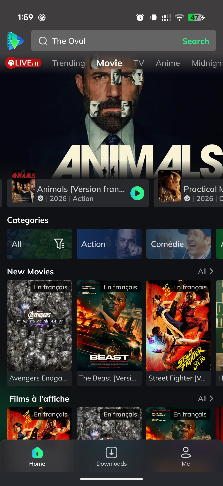

# MovieBox (No Force Update & Adds)

**An independent Android patch for one known forced-update dialog.**

[](https://github.com/emransm877/moviebox-android/actions/workflows/check.yml)
[](https://github.com/emransm877/moviebox-android/releases/latest)

[Project website & download insights](https://emransm877.github.io/moviebox-projects/) · [Troubleshooting](docs/TROUBLESHOOTING.md) · [Report a bug](https://github.com/emransm877/moviebox-android/issues/new/choose)

The repository title is retained from the original project name. **General
advertising removal is not implemented or verified.** “Adds” must not be read as
a verified ad-blocking claim. Memberships, login and service access are unchanged.

This is patch source and build tooling for a specific reviewed APK, not a
general-purpose patcher or an official MovieBox release. The installed launcher
name is **MovieBox**, with separate package `com.community.mbox.in.popupfree`.

## Download and install

[**Download the published Android APK — 0.2.0**](https://github.com/emransm877/moviebox-android/releases/download/v0.2.0/MovieBox-Android-0.2.0.apk)

1. Use an **ARM64 Android 10+** phone and download the APK from the link above.
2. Compare its SHA-256 with the file on the [release page](https://github.com/emransm877/moviebox-android/releases/tag/v0.2.0).
3. Open the APK. If Android asks, allow this installation from the browser or file
   manager you used. Do not disable Play Protect or other device security protections.
4. Open **MovieBox**. No PC, compiler or root access is required to use this APK.

For an update, keep the working app installed. Android preserves its data only
when the package and signing certificate match. **Do not uninstall just to bypass
a signature conflict.** This patched copy installs separately from the reviewed
source package. See [installation troubleshooting](docs/TROUBLESHOOTING.md).

## Actual Android interface



*Real USB capture of the published 0.2.0 APK after a signature-matched in-place update on the maintainer's phone. Launch, browsing and observed playback are bounded checks, not universal certification. The upstream manifest version is preserved and does not identify the patch release. Catalogue artwork remains third-party material.*

## What the patch does—and does not do

| Behavior | Scope |
| --- | --- |
| Known forced-update dialog | Matches the reviewed English title/message, hides that dialog and lets input reach the underlying app. |
| Separate installation | Uses the isolated patched package; launcher label is MovieBox. |
| Observed ARM64 clone startup fault | Narrow workaround for the observed non-main-thread SIGBUS at address `0xa01`. |
| Patch release reminders | Optional daily GitHub check with Download, Later, Skip and a disable switch. No automatic APK download or installation. |
| General advertising removal | Not implemented or verified. |
| Memberships and service restrictions | Unchanged. |

Optional notices are deferred during playback and uncertain activity states.
Disabling checks is local to this patch; the current implementation has no separate
re-enable screen. Read the [notice behavior and validation limits](docs/UPDATE_NOTICE.md).

## Compatibility and validation limits

- The patch supports ARM64 Android 10/API 29 or newer, even though the upstream
  manifest permits a lower minimum. Other ABIs and older Android versions are unsupported.
- Newer OS versions, 16 KB page-size devices and manufacturers are not all tested.
- The known dialog guard and native helper previously worked during an observed
  playback session. The released 0.2.0 notice needs additional exact-APK device validation.
- CI checks patch source using synthetic fixtures; it cannot certify every runtime
  behavior of the external protected application.
- A different APK, changed server prompt or translated dialog needs a new investigation.

## Build and contribute

The original APK, protected payloads, third-party runtimes and signing keys are
not committed here. Obtain the exact supported source separately. Use the pinned
source hash and toolchain in [the build guide](docs/BUILD.md); never generate a new
signing key to replace an existing installation's identity.

```powershell
python -m unittest discover -s tests -v
python tools/check_release.py
```

The optional real-manifest test requires the external `MOVIEBOX_SOURCE_APK`
fixture. See [the release checklist](docs/RELEASE_PROCESS.md), [findings](docs/REVERSE_ENGINEERING.md),
[CONTRIBUTING.md](CONTRIBUTING.md) and [SECURITY.md](SECURITY.md).

Bug reports should include the downloaded patch release, phone model, Android
version and repeatable steps. Keep APKs, device serials, passwords, accounts,
signing keys and signed media URLs out of public issues.

## Related project and licensing

[MovieBox Desktop for Windows](https://github.com/emransm877/moviebox-desktop)
provides a native desktop interface; it is a separate project, not an Android emulator.

Maintained by [Emran Hossain](https://github.com/emransm877). Not affiliated with or
endorsed by MovieBox or Google. MIT applies to independently authored patch source
and tooling, not to the complete derived APK. Upstream code, assets and names
retain their respective owners' rights. See [third-party notices](THIRD_PARTY_NOTICES.md).
